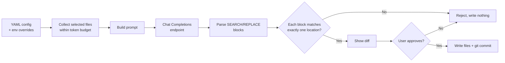

# AI Pair-Programming Assistant

A terminal coding assistant that lets a developer ask an LLM questions about files in a git repository and apply the model's proposed edits as **reviewed, approved git commits**, with safety checks so the model can never silently change code.

> **Note:** I built this as a course project for *Applied Agentic Software Engineering* at the University of Michigan (Sep–Oct 2026). The source code is private under course academic-integrity rules. This page describes the design, the safety rules, and how I tested the model's behavior. I'm happy to walk through the implementation in an interview.

**Tech:** Python · LLM Chat Completions API (tested with a locally hosted model through Ollama) · Git · pytest · YAML

---

## What it does

1. The user selects files from a target git repository.
2. The assistant sends those files to an LLM, staying within a configurable **token budget**.
3. The user can **ask questions** about the code, or **request an edit**.
4. For edits, the model replies with structured **SEARCH/REPLACE** blocks.
5. The assistant validates every block, shows the user a **diff**, and only writes and commits after explicit approval.
6. A guarded **`/undo`** reverts the assistant's last commit when it is safe to do so.

## How the model is integrated

- **Endpoint-agnostic client:** works with any chat-completions-compatible model endpoint. The model, URL, and limits come from validated YAML config, which environment variables can override.
- **Structured edit format:** the model must express changes as SEARCH/REPLACE blocks, so every edit is checkable before anything touches disk.

## Safety rules

The model's output is treated as **untrusted** until verified:

| Situation | What the assistant does |
|---|---|
| SEARCH text matches zero or multiple locations | Rejects the edit, writes nothing |
| Model reply is malformed | Rejects the reply, writes nothing |
| User cancels at the diff | Writes nothing |
| Working tree is dirty before an edit | Refuses to apply edits |
| `/undo` when the tree is dirty or newer commits exist | Refuses to revert |

## How I tested the model's behavior

- **Offline pytest suite:** unit tests for the edit parser, configuration validation, and safety refusals. It runs without a model, so it's fast and deterministic.
- **Live evaluation:** a scripted protocol of three real edit requests against the model, checked by a **deterministic checker script** that verifies the resulting file contents, number of commits, and working-tree state. Pass or fail is decided by the checker, not by eye.
- **Prompt iteration (recorded):** my first edit prompt included an example that was too close to the test requests, so the model could copy its pattern instead of following the instructions. I removed that leading example and added explicit rules that each SEARCH block must match exactly one location. The revised prompt passed **3/3** live requests.

## Process

- Wrote a system design document and architecture diagrams (Mermaid) before writing code.
- Built in small, spec-driven increments, using an AI coding agent (Aider) and reviewing and testing everything it produced before committing.

## What I learned

- LLM output needs the same validation as any other untrusted input. Most of the engineering went into making edits verifiable and reversible.
- Evaluating a model needs objective, repeatable checks. A deterministic checker made prompt changes measurable.
- Test examples in a prompt can leak into the model's behavior. Keeping them distinct from the evaluation cases matters.

---

*Abdul Wasay Khan · University of Michigan, B.S. Computer Science (Dec. 2026) · [LinkedIn](https://linkedin.com/in/abdul-khan-762553236)*
